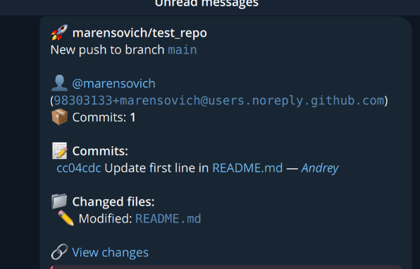
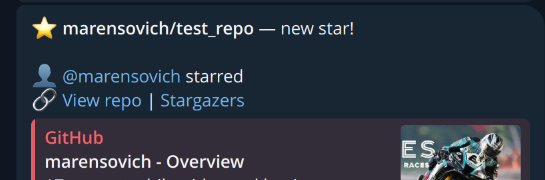
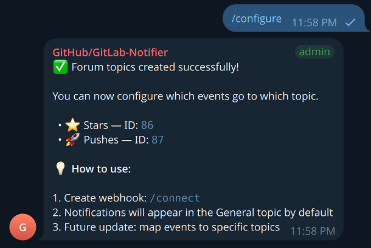
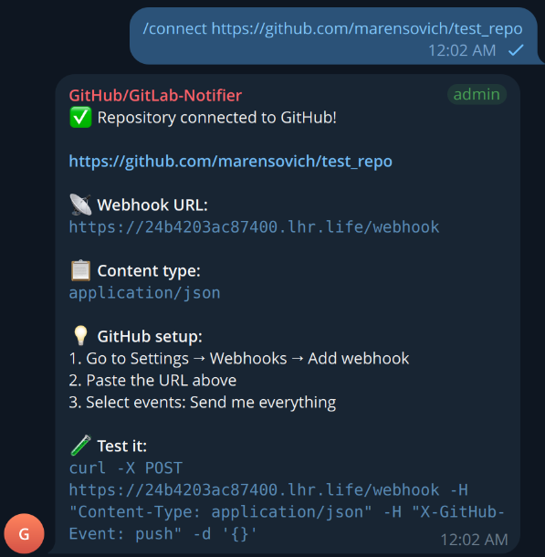

# GitHub-GitLab Notifier

[](https://github.com/marensovich/GitHub-GitLab-Notifier/actions/workflows/ci.yml)
[](https://github.com/marensovich/GitHub-GitLab-Notifier/releases)


[](LICENSE)

A lightweight, self-hosted Telegram bot that delivers real-time notifications from your **GitHub** and **GitLab**
repositories to a Telegram **forum** chat — every kind of event in its own topic.

**Why?** Because sometimes you don't want to check email or open an app — you just want a message when something
happens in your repo.

- 🔔 **19 event types** from GitHub and GitLab: pushes, tags, pull/merge requests, reviews, issues, comments,
  releases, CI pipelines, stars, forks
- 🗂 **Forum topics**: Stars, Pushes, Pull Requests, Issues, Releases and CI/CD are created automatically
- 🔐 **Signed webhooks**: GitHub HMAC-SHA256 signatures and GitLab secret tokens are verified
- 🌍 **Per-chat language**: English and Russian, switchable with `/lang`
- 🧩 **Single static binary**: embedded translations, pure-Go SQLite, no runtime dependencies
- 🐧 **One-command Linux install** as a hardened systemd service, or run it with Docker
- 🏠 **Self-hosted GitLab** and self-hosted Telegram Bot API server supported

---

## Table of contents

- [Screenshots](#-screenshots)
- [Supported events](#-supported-events)
- [Quick start](#-quick-start)
- [Installation on Linux (systemd)](#-installation-on-linux-systemd)
- [Running with Docker](#-running-with-docker)
- [Building from source](#-building-from-source)
- [Bot commands](#-bot-commands)
- [Environment variables](#environment-variables)
- [Webhook security](#-webhook-security)
- [How notifications are routed](#-how-notifications-are-routed)
- [HTTPS with a reverse proxy](#-https-with-a-reverse-proxy)
- [Project structure](#-project-structure)
- [Development](#-development)
- [Troubleshooting](#-troubleshooting)

---

## 📸 Screenshots

| New commits                   | New star                        |
|:------------------------------|:--------------------------------|
|  |    |

| Automatic forum setup             | Connecting a repository             |
|:----------------------------------|:------------------------------------|
|   |    |

---

## 🔔 Supported events

### GitHub (`X-GitHub-Event`)

| Event                 | Reported actions                                                     | Topic            |
|:----------------------|:---------------------------------------------------------------------|:-----------------|
| `push`                | new commits, force push, branch created/deleted, tag created/deleted | 🚀 Pushes        |
| `pull_request`        | opened (incl. draft), closed, merged, reopened, ready for review     | 🔀 Pull Requests |
| `pull_request_review` | approved, changes requested, commented                               | 🔀 Pull Requests |
| `issues`              | opened, closed (incl. "not planned"), reopened                       | 🐛 Issues        |
| `issue_comment`       | new comment on an issue or pull request                              | 🐛 Issues        |
| `release`             | published release / pre-release                                      | 📦 Releases      |
| `workflow_run`        | completed GitHub Actions run: success, failure, cancelled            | ⚙️ CI/CD         |
| `star`                | starred, unstarred                                                   | ⭐ Stars          |
| `fork`                | repository forked                                                    | ⭐ Stars          |
| `ping`                | webhook created (setup confirmation)                                 | General          |

### GitLab (`X-Gitlab-Event`)

| Event                                         | Reported actions                                  | Topic            |
|:----------------------------------------------|:--------------------------------------------------|:-----------------|
| `Push Hook`                                   | new commits, branch created/deleted               | 🚀 Pushes        |
| `Tag Push Hook`                               | tag created/deleted                               | 🚀 Pushes        |
| `Merge Request Hook`                          | opened (incl. draft), closed, merged, reopened, approved | 🔀 Pull Requests |
| `Issue Hook`, `Confidential Issue Hook`       | opened, closed, reopened                          | 🐛 Issues        |
| `Note Hook`, `Confidential Note Hook`         | comment on an issue, merge request or commit      | 🐛 Issues        |
| `Pipeline Hook`                               | finished pipeline: success, failed, canceled      | ⚙️ CI/CD         |
| `Release Hook`                                | release created                                   | 📦 Releases      |

Noisy actions (labels, assignments, edits, PR synchronization, in-progress pipelines, …) are intentionally skipped.
Events the bot does not know (e.g. `check_suite`, `deployment`) are ignored, so you can safely select
**"Send me everything"** on GitHub. Set `NOTIFY_UNKNOWN_EVENTS=true` to get a short message for them instead.

---

## 🚀 Quick start

### 1. Create a Telegram bot

1. Open [@BotFather](https://t.me/BotFather) and send `/newbot`
2. Choose a name and a username
3. Copy the **token**

### 2. Create a forum group

1. Create a Telegram group and enable **Topics** (group settings → *Topics*)
2. Add your bot to the group
3. **Make the bot an administrator** with the *Manage topics* right

> Regular groups and private chats work too, but all notifications then arrive in one chat without topics.

### 3. Install the bot

Pick one:

- **Linux server (recommended):** `curl -fsSL https://raw.githubusercontent.com/marensovich/GitHub-GitLab-Notifier/master/scripts/install.sh | sudo bash`
  — see [Installation on Linux](#-installation-on-linux-systemd)
- **Docker:** see [Running with Docker](#-running-with-docker)
- **From source:** see [Building from source](#-building-from-source)

The bot must be reachable from the internet (GitHub/GitLab send webhooks to it). Set `DOMAIN` to your public domain
or IP (with port, if you don't use a reverse proxy).

### 4. Set up the chat

In the forum group, send:

```
/configure
/connect https://github.com/your-username/your-repo
```

`/configure` creates the topics, `/connect` replies with the **webhook URL** and a **secret**.

### 5. Add the webhook

**GitHub:** repository → **Settings** → **Webhooks** → **Add webhook**

| Field        | Value                                               |
|:-------------|:----------------------------------------------------|
| Payload URL  | URL from `/connect`                                 |
| Content type | `application/json`                                  |
| Secret       | secret from `/connect`                              |
| Events       | *Send me everything* (or pick the ones you need)    |

**GitLab:** project → **Settings** → **Webhooks** → **Add new webhook**

| Field        | Value                                                                       |
|:-------------|:----------------------------------------------------------------------------|
| URL          | URL from `/connect`                                                         |
| Secret token | secret from `/connect`                                                      |
| Triggers     | Push, Tag push, Merge request, Issues, Comments, Pipeline, Releases          |

GitHub immediately sends a `ping` event — a "Webhook connected" message appears in the chat. 🎉

---

## 🐧 Installation on Linux (systemd)

`scripts/install.sh` installs the bot as a systemd service that starts on boot and restarts automatically on failure.
It works on any systemd-based distribution (Debian, Ubuntu, Fedora, RHEL/Rocky/Alma, Arch, openSUSE, Raspberry Pi OS)
on **amd64**, **arm64** and **armv7** (32-bit Raspberry Pi).

### Install

Latest release, interactive setup:

```bash
curl -fsSL https://raw.githubusercontent.com/marensovich/GitHub-GitLab-Notifier/master/scripts/install.sh | sudo bash
```

From a cloned repository (builds from source, requires Go 1.26+):

```bash
git clone https://github.com/marensovich/GitHub-GitLab-Notifier.git
cd GitHub-GitLab-Notifier
sudo ./scripts/install.sh install --from-source
```

Unattended (e.g. Ansible, cloud-init) — settings come from environment variables:

```bash
sudo BOT_TOKEN=123456:ABC... TELEGRAM_BOT_USERNAME=MyGitBot DOMAIN=bot.example.com USE_HTTPS=true \
     ./scripts/install.sh install --non-interactive
```

The installer:

1. downloads the release binary for your architecture (or builds it / takes `--binary <path>`);
2. creates the unprivileged system user `notifier`;
3. asks for the bot token, port, domain, language, … and writes the config;
4. installs and enables the `github-gitlab-notifier` systemd unit, starts it and checks `/health`.

| What          | Where                                                 |
|:--------------|:------------------------------------------------------|
| Binary        | `/opt/github-gitlab-notifier/github-gitlab-notifier`  |
| Configuration | `/etc/github-gitlab-notifier/notifier.env` (`0640`)   |
| Database      | `/var/lib/github-gitlab-notifier/notifier.db`         |
| Unit          | `/etc/systemd/system/github-gitlab-notifier.service`  |

### Manage

```bash
sudo systemctl status github-gitlab-notifier
```

```bash
sudo systemctl restart github-gitlab-notifier   # after editing the config
```

```bash
sudo journalctl -u github-gitlab-notifier -f    # live logs
```

```bash
sudo ./scripts/install.sh update                # new version, automatic rollback if it fails to start
```

```bash
sudo ./scripts/install.sh uninstall --purge     # remove everything incl. config and database
```

| Option              | Description                                                   |
|:--------------------|:--------------------------------------------------------------|
| `--version vX.Y.Z`  | Install a specific release instead of the latest              |
| `--from-source`     | Build from the local checkout with Go                         |
| `--binary <path>`   | Install an already built binary                               |
| `--non-interactive` | Never prompt; read settings from environment variables        |
| `--purge`           | With `uninstall`: also delete configuration, data and user    |

The unit is sandboxed (`ProtectSystem=strict`, `ProtectHome`, `PrivateTmp`, `NoNewPrivileges`, no capabilities, only
the data directory writable). Ports below 1024 get only `CAP_NET_BIND_SERVICE`.

---

## 🐳 Running with Docker

```bash
cp .env.example .env    # fill in BOT_TOKEN, DOMAIN, ...
docker compose up -d
```

The image is built from the included `Dockerfile` (distroless, non-root, ~24 MB). The database is stored in the
`data` volume. Logs: `docker compose logs -f`.

---

## 🛠 Building from source

Requires **Go 1.26+**.

```bash
git clone https://github.com/marensovich/GitHub-GitLab-Notifier.git
cd GitHub-GitLab-Notifier
cp .env.example .env    # edit it
make build
./GitHub-GitLab-Notifier
```

Expected output:

```
✅ Storage initialized (SQLite)
✅ Bot using direct connection
✅ Bot @YourGitBot registered. Session active
🚀 Bot @YourGitBot started, listening for commands...
✅ Dispatcher initialized with 19 handlers
🚀 Server listening on 0.0.0.0:8080 (version v0.1.0)
```

Command-line flags:

| Flag              | Description                                                |
|:------------------|:-----------------------------------------------------------|
| `--config <path>` | Path to the `.env` file (default `.env`)                   |
| `--db <path>`     | SQLite database path (overrides `DB_PATH`)                 |
| `--lang en\|ru`   | Default language (overrides `BOT_LANG`)                    |
| `--version`       | Print version and exit                                     |

Pre-built binaries for Linux, macOS, Windows and FreeBSD are attached to every
[release](https://github.com/marensovich/GitHub-GitLab-Notifier/releases).

---

## 🤖 Bot commands

| Command               | Description                                                       |
|:----------------------|:------------------------------------------------------------------|
| `/start`              | Welcome message and quick start                                   |
| `/help`               | List of commands                                                  |
| `/configure`          | Create forum topics and map events to them (safe to run again)    |
| `/connect <url>`      | Connect a repository: returns webhook URL, secret and instructions |
| `/disconnect <url>`   | Disconnect a repository from this chat                            |
| `/status`             | Chat settings, topics, connected repositories, version            |
| `/lang en` / `/lang ru` | Change the language of this chat                                |
| `/version`            | Bot version                                                       |

The commands also appear in Telegram's **Menu** button.

---

## Environment variables

| Variable                | Required | Default            | Description                                                         |
|:------------------------|:---------|:-------------------|:--------------------------------------------------------------------|
| `BOT_TOKEN`             | **Yes**  | —                  | Telegram bot token from [@BotFather](https://t.me/BotFather)        |
| `TELEGRAM_BOT_USERNAME` | No       | —                  | Bot username without `@` (informational)                            |
| `DOMAIN`                | **Yes**¹ | —                  | Public domain or `IP:port` used in the webhook URL from `/connect`  |
| `USE_HTTPS`             | No       | `true`             | Use `https://` in the webhook URL                                   |
| `SERVER_ADDRESS`        | No       | all interfaces     | Listen address (`127.0.0.1` behind a reverse proxy)                 |
| `SERVER_PORT`           | No       | `8080`             | HTTP port for webhooks                                              |
| `BOT_LANG`              | No       | `en`               | Default language (`en`, `ru`); each chat can change it with `/lang` |
| `CHAT_ID`               | No       | —                  | Fallback chat used while no chat is configured                      |
| `WEBHOOK_SECRET`        | No       | —                  | Global secret; when set, unsigned webhooks are rejected             |
| `DB_PATH`               | No       | `data/notifier.db` | SQLite database file                                                |
| `NOTIFY_UNKNOWN_EVENTS` | No       | `false`            | Post a short message for unsupported events                         |
| `PROXY_ENABLED`         | No       | `false`            | Use a proxy for the Telegram API                                    |
| `PROXY_HOST`            | No       | —                  | Proxy host                                                          |
| `PROXY_PORT`            | No       | —                  | Proxy port                                                          |
| `PROXY_TYPE`            | No       | `HTTP`             | `HTTP` or `SOCKS` (SOCKS5)                                          |
| `TELEGRAM_API_URL`      | No       | —                  | Self-hosted [Telegram Bot API server](https://github.com/tdlib/telegram-bot-api) |

¹ Required for `/connect` to generate the webhook URL.

---

## 🔐 Webhook security

Every repository connected with `/connect` gets its own random **secret**:

- **GitHub** signs each delivery with it (`X-Hub-Signature-256`, HMAC-SHA256) — the bot verifies the signature;
- **GitLab** sends it in `X-Gitlab-Token` — the bot compares it in constant time.

A request with a wrong signature/token is rejected with `401`. Webhooks created without a secret keep working,
unless you set the global `WEBHOOK_SECRET` — then **every** webhook must be signed with either the repository secret or
`WEBHOOK_SECRET`. This is recommended for public servers.

---

## 🧭 How notifications are routed

1. The repository URL is taken from the payload (`repository.html_url` / `project.web_url`).
2. If the repository was connected with `/connect`, the message goes **only to that chat**.
   Otherwise it goes to every configured chat, or to `CHAT_ID` if there are none.
3. The event is formatted in each chat's language.
4. The message is posted to the topic mapped to the event category; if the topic was deleted, it falls back to the
   General topic.

---

## 🔒 HTTPS with a reverse proxy

GitHub and GitLab recommend HTTPS for webhooks. Run the bot on localhost and put a reverse proxy in front of it:

**Caddy** (automatic Let's Encrypt certificates):

```
bot.example.com {
    reverse_proxy 127.0.0.1:8080
}
```

**nginx:**

```nginx
server {
    listen 443 ssl;
    server_name bot.example.com;
    # ssl_certificate ... / ssl_certificate_key ...

    location /webhook {
        proxy_pass http://127.0.0.1:8080;
        proxy_set_header Host $host;
    }
}
```

Then set `SERVER_ADDRESS=127.0.0.1`, `DOMAIN=bot.example.com` and `USE_HTTPS=true`.

---

## 📁 Project structure

```
.
├── main.go                    # entry point: config, wiring, graceful shutdown
├── locales/                   # translations (embedded into the binary)
├── internal/
│   ├── bot/                   # Telegram bot: commands, /configure, sending
│   ├── dispatcher/            # routes an event to its handler
│   ├── handler/               # one handler per GitHub/GitLab event + formatting
│   │   └── testdata/          # real-world webhook payloads used by tests
│   ├── i18n/                  # translation loading and lookup
│   ├── platform/              # platforms, event types, topics
│   └── server/                # HTTP webhook endpoint, signatures, routing
├── storage/                   # SQLite: chats, topics, repos, event mapping
├── scripts/install.sh         # Linux systemd installer
├── Dockerfile, docker-compose.yml
└── .github/workflows/         # CI and release pipelines
```

### Database

SQLite file (`DB_PATH`, default `data/notifier.db`):

| Table           | Description                          |
|:----------------|:-------------------------------------|
| `chats`         | Configured chats and their language  |
| `topics`        | Created forum topics                 |
| `repos`         | Connected repositories and secrets   |
| `event_mapping` | Event category → topic, per chat     |

---

## 👩‍💻 Development

```bash
make help     # list all targets
make test     # run tests
make lint     # gofmt + go vet + shellcheck
make run      # run locally with .env
```

Want another event? Adding a handler takes about 50 lines of Go — see [CONTRIBUTING.md](CONTRIBUTING.md).

---

## 🩺 Troubleshooting

| Problem                                   | Solution                                                                    |
|:------------------------------------------|:----------------------------------------------------------------------------|
| Topics are not created                    | The bot must be an **administrator** with the *Manage topics* right          |
| "This chat is not a forum"                | Enable **Topics** in the group settings                                     |
| Webhook shows a delivery error on GitHub  | The URL must be reachable from the internet — check `DOMAIN`, port, firewall |
| GitHub shows `401 Unauthorized`           | The webhook secret does not match the one from `/connect` (or `WEBHOOK_SECRET`) |
| Notifications go to the General topic     | Run `/configure` again — it creates missing topics and restores the mapping |
| No message for an event                   | Check that the event is [supported](#-supported-events) and selected in the webhook settings |
| Wrong address in `/connect` output        | Set `DOMAIN` (and `USE_HTTPS`) in the configuration                          |
| Bot can't connect to Telegram             | Configure `PROXY_*` or `TELEGRAM_API_URL`                                   |
| Service does not start                    | `sudo journalctl -u github-gitlab-notifier -n 50`                           |

---

## Tech stack

- **Go** — single static binary, cross-compiled for every platform
- **[telego](https://github.com/mymmrac/telego)** — Telegram Bot API client
- **[modernc.org/sqlite](https://modernc.org/sqlite)** — pure Go SQLite, no CGO
- **[godotenv](https://github.com/joho/godotenv)** — `.env` configuration

## License

MIT © [marensovich](https://github.com/marensovich)
