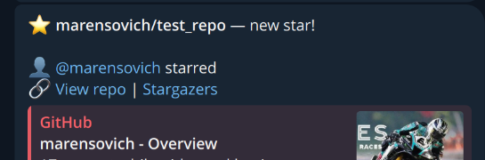
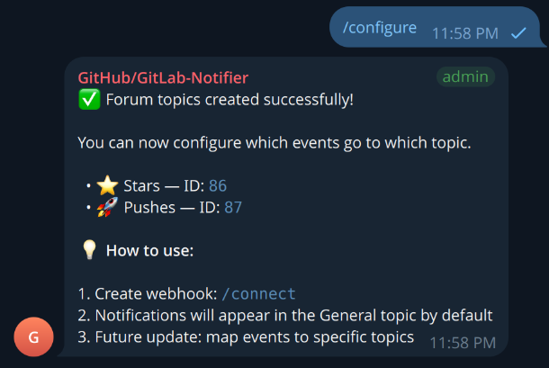

# GitHub-GitLab Notifier

[](https://github.com/marensovich/GitHub-GitLab-Notifier/actions/workflows/ci.yml)
[](https://github.com/marensovich/GitHub-GitLab-Notifier/releases)
[](https://github.com/marensovich/GitHub-GitLab-Notifier/pkgs/container/github-gitlab-notifier)


[](LICENSE)

A lightweight, self-hosted Telegram bot that delivers real-time notifications from your **GitHub** and **GitLab**
repositories to a Telegram **forum** chat — every kind of event in its own topic.

**Why?** Because sometimes you don't want to check email or open an app — you just want a message when something
happens in your repo.

- 🔔 **19 event types** from GitHub and GitLab: pushes, tags, pull/merge requests, reviews, issues, comments,
  releases, CI pipelines, stars, forks
- 🗂 **Forum topics**: Stars, Pushes, Pull Requests, Issues, Releases and CI/CD are created automatically
- 🔐 **Signed webhooks**: GitHub HMAC-SHA256 signatures and GitLab secret tokens are verified
- 🌍 **Per-chat language**: English and Russian, switchable with `/lang`
- 🧩 **Single static binary**: embedded translations, pure-Go SQLite, no runtime dependencies
- 🐧 **One-command Linux install** as a hardened systemd service, or run it with Docker
- 🏠 **Self-hosted GitLab** and self-hosted Telegram Bot API server supported

---

## Table of contents

- [Screenshots](#-screenshots)
- [Supported events](#-supported-events)
- [Quick start](#-quick-start)
- [Discord](#-discord)
- [Installation on Linux (systemd)](#-installation-on-linux-systemd)
- [Running with Docker](#-running-with-docker)
- [Building from source](#-building-from-source)
- [Bot commands](#-bot-commands)
- [Personal DMs](#-personal-dms)
- [Environment variables](#environment-variables)
- [Web panel](#-web-panel)
- [Monitoring](#-monitoring)
- [Webhook security](#-webhook-security)
- [How notifications are routed](#-how-notifications-are-routed)
- [HTTPS with a reverse proxy](#-https-with-a-reverse-proxy)
- [Project structure](#-project-structure)
- [Development](#-development)
- [Troubleshooting](#-troubleshooting)

---

## 📸 Screenshots

| New commits                   | New star                        |
|:------------------------------|:--------------------------------|
|  |    |

| Automatic forum setup             | Connecting a repository             |
|:----------------------------------|:------------------------------------|
|   |    |

---

## 🔔 Supported events

### GitHub (`X-GitHub-Event`)

| Event                 | Reported actions                                                     | Topic            |
|:----------------------|:---------------------------------------------------------------------|:-----------------|
| `push`                | new commits, force push, branch created/deleted, tag created/deleted | 🚀 Pushes        |
| `pull_request`        | opened (incl. draft), closed, merged, reopened, ready for review     | 🔀 Pull Requests |
| `pull_request_review` | approved, changes requested, commented                               | 🔀 Pull Requests |
| `issues`              | opened, closed (incl. "not planned"), reopened                       | 🐛 Issues        |
| `issue_comment`       | new comment on an issue or pull request                              | 🐛 Issues        |
| `release`             | published release / pre-release                                      | 📦 Releases      |
| `workflow_run`        | completed GitHub Actions run: success, failure, cancelled            | ⚙️ CI/CD         |
| `star`                | starred, unstarred                                                   | ⭐ Stars          |
| `fork`                | repository forked                                                    | ⭐ Stars          |
| `ping`                | webhook created (setup confirmation)                                 | General          |

### GitLab (`X-Gitlab-Event`)

| Event                                         | Reported actions                                  | Topic            |
|:----------------------------------------------|:--------------------------------------------------|:-----------------|
| `Push Hook`                                   | new commits, branch created/deleted               | 🚀 Pushes        |
| `Tag Push Hook`                               | tag created/deleted                               | 🚀 Pushes        |
| `Merge Request Hook`                          | opened (incl. draft), closed, merged, reopened, approved | 🔀 Pull Requests |
| `Issue Hook`, `Confidential Issue Hook`       | opened, closed, reopened                          | 🐛 Issues        |
| `Note Hook`, `Confidential Note Hook`         | comment on an issue, merge request or commit      | 🐛 Issues        |
| `Pipeline Hook`                               | finished pipeline: success, failed, canceled      | ⚙️ CI/CD         |
| `Release Hook`                                | release created                                   | 📦 Releases      |

Noisy actions (labels, assignments, edits, PR synchronization, in-progress pipelines, …) are intentionally skipped.
Events the bot does not know (e.g. `check_suite`, `deployment`) are ignored, so you can safely select
**"Send me everything"** on GitHub. Set `NOTIFY_UNKNOWN_EVENTS=true` to get a short message for them instead.

---

## 🚀 Quick start

### 1. Create a Telegram bot

1. Open [@BotFather](https://t.me/BotFather) and send `/newbot`
2. Choose a name and a username
3. Copy the **token**

### 2. Create a forum group

1. Create a Telegram group and enable **Topics** (group settings → *Topics*)
2. Add your bot to the group
3. **Make the bot an administrator** with the *Manage topics* right

> Regular groups and private chats work too, but all notifications then arrive in one chat without topics.

### 3. Install the bot

Pick one:

- **Linux server (recommended):** `curl -fsSL https://raw.githubusercontent.com/marensovich/GitHub-GitLab-Notifier/master/scripts/install.sh | sudo bash`
  — see [Installation on Linux](#-installation-on-linux-systemd)
- **Docker:** see [Running with Docker](#-running-with-docker)
- **From source:** see [Building from source](#-building-from-source)

The bot must be reachable from the internet (GitHub/GitLab send webhooks to it). Set `DOMAIN` to your public domain
or IP (with port, if you don't use a reverse proxy).

### 4. Set up the chat

In the forum group, send:

```
/configure
/connect https://github.com/your-username/your-repo
```

`/configure` asks two questions with buttons — whether to create a topic per event type (forum chats only) and
which look to use — and `/connect` replies with the **webhook URL** and a **secret**.

**Message look.** The new look uses Telegram *rich messages*: a heading, a compact table of details, collapsible
commit and file lists and coloured buttons. It needs an up-to-date official Telegram app; old and third-party
clients show it as an unsupported message. If your chat reads notifications there, pick **Classic** in
`/configure` — the same information as plain formatted text with inline buttons. `RICH_MESSAGES=false` sends every
chat the classic look.

### 5. Add the webhook

**GitHub:** repository → **Settings** → **Webhooks** → **Add webhook**

| Field        | Value                                               |
|:-------------|:----------------------------------------------------|
| Payload URL  | URL from `/connect`                                 |
| Content type | `application/json`                                  |
| Secret       | secret from `/connect`                              |
| Events       | *Send me everything* (or pick the ones you need)    |

**GitLab:** project → **Settings** → **Webhooks** → **Add new webhook**

| Field        | Value                                                                       |
|:-------------|:----------------------------------------------------------------------------|
| URL          | URL from `/connect`                                                         |
| Secret token | secret from `/connect`                                                      |
| Triggers     | Push, Tag push, Merge request, Issues, Comments, Pipeline, Releases          |

GitHub immediately sends a `ping` event — a "Webhook connected" message appears in the chat. 🎉

---

## 💬 Discord

The same bot can post to Discord channels and forums, next to Telegram or on its own. Discord reaches the bot
over HTTPS, so `server.public_url` must be reachable from the internet.

1. Open the [Discord developer portal](https://discord.com/developers/applications) → **New Application**.
2. **Bot** → **Reset Token** and copy it. No privileged intents are needed.
3. **General Information**: copy the **Application ID** and the **Public Key**.
4. Fill in `config.yaml` and restart the bot:

   ```yaml
   messengers:
     discord:
       enabled: true
       token: "${DISCORD_TOKEN}"
       application_id: "112233445566778899"
       public_key: "<64 hex characters>"
   ```

5. Back in **General Information**, set **Interactions Endpoint URL** to
   `<server.public_url>/discord/interactions` and save; Discord checks it right away, so the bot must be running.
6. Invite the bot with the link from the log (`🔗 Discord: invite the bot with …`). It asks for: view channels,
   send messages, embed links, read message history, create public threads and send messages in threads.

Commands are slash commands (`/connect`, `/configure`, `/status`, …) and work in server channels only. Only the
person who typed a command sees the answer. `/configure` needs the **Manage Channels** permission.

In a **forum channel** every category of events gets its own post, created by `/configure` (type it inside any
post of the forum); a post that is deleted is created again with the next event. In a text channel everything
goes to the channel.

---

## 🐧 Installation on Linux (systemd)

`scripts/install.sh` installs the bot as a systemd service that starts on boot and restarts automatically on failure.
It works on any systemd-based distribution (Debian, Ubuntu, Fedora, RHEL/Rocky/Alma, Arch, openSUSE, Raspberry Pi OS)
on **amd64**, **arm64** and **armv7** (32-bit Raspberry Pi).

### Install

Latest release, interactive setup:

```bash
curl -fsSL https://raw.githubusercontent.com/marensovich/GitHub-GitLab-Notifier/master/scripts/install.sh | sudo bash
```

From a cloned repository (builds from source, requires Go 1.26+):

```bash
git clone https://github.com/marensovich/GitHub-GitLab-Notifier.git
cd GitHub-GitLab-Notifier
sudo ./scripts/install.sh install --from-source
```

Unattended (e.g. Ansible, cloud-init) — settings come from environment variables:

```bash
sudo BOT_TOKEN=123456:ABC... TELEGRAM_BOT_USERNAME=MyGitBot DOMAIN=bot.example.com USE_HTTPS=true \
     ./scripts/install.sh install --non-interactive
```

The installer:

1. downloads the release binary for your architecture (or builds it / takes `--binary <path>`);
2. creates the unprivileged system user `notifier`;
3. asks for the bot token, port, domain, language, … and writes the config;
4. installs and enables the `github-gitlab-notifier` systemd unit, starts it and checks `/health`.

| What          | Where                                                 |
|:--------------|:------------------------------------------------------|
| Binary        | `/opt/github-gitlab-notifier/github-gitlab-notifier`  |
| Configuration | `/etc/github-gitlab-notifier/notifier.env` (`0640`)   |
| Database      | `/var/lib/github-gitlab-notifier/notifier.db`         |
| Unit          | `/etc/systemd/system/github-gitlab-notifier.service`  |

### Manage

```bash
sudo systemctl status github-gitlab-notifier
```

```bash
sudo systemctl restart github-gitlab-notifier   # after editing the config
```

```bash
sudo journalctl -u github-gitlab-notifier -f    # live logs
```

```bash
sudo ./scripts/install.sh update                # new version, automatic rollback if it fails to start
```

```bash
sudo ./scripts/install.sh uninstall --purge     # remove everything incl. config and database
```

| Option              | Description                                                   |
|:--------------------|:--------------------------------------------------------------|
| `--version vX.Y.Z`  | Install a specific release instead of the latest              |
| `--from-source`     | Build from the local checkout with Go                         |
| `--binary <path>`   | Install an already built binary                               |
| `--non-interactive` | Never prompt; read settings from environment variables        |
| `--purge`           | With `uninstall`: also delete configuration, data and user    |

The unit is sandboxed (`ProtectSystem=strict`, `ProtectHome`, `PrivateTmp`, `NoNewPrivileges`, no capabilities, only
the data directory writable). Ports below 1024 get only `CAP_NET_BIND_SERVICE`.

---

## 🐳 Running with Docker

A ready image for `linux/amd64`, `linux/arm64` (Raspberry Pi 4/5, ARM VPS) and `linux/arm/v7` is published to
GitHub Container Registry: `ghcr.io/marensovich/github-gitlab-notifier` (distroless, non-root, ~24 MB).

With Docker Compose (uses the `docker-compose.yml` from this repository):

```bash
cp .env.example .env    # fill in BOT_TOKEN, DOMAIN, ...
docker compose up -d
```

Or with plain Docker:

```bash
docker run -d --name notifier --restart unless-stopped \
  --env-file .env -p 8080:8080 -v notifier-data:/data \
  ghcr.io/marensovich/github-gitlab-notifier:latest
```

| Tag               | What                                                         |
|:------------------|:-------------------------------------------------------------|
| `latest`          | Latest stable release                                        |
| `1.1`, `1.1.0`    | A minor line (gets patch updates) or an exact version        |
| `edge`            | Latest `development` build — may be unstable                 |

The database is stored in the `/data` volume. Logs: `docker compose logs -f`. Update: `docker compose pull &&
docker compose up -d`. To build the image yourself from a checkout: `docker compose up -d --build`.

---

## 🛠 Building from source

Requires **Go 1.26+**.

```bash
git clone https://github.com/marensovich/GitHub-GitLab-Notifier.git
cd GitHub-GitLab-Notifier
cp .env.example .env    # edit it
make build
./GitHub-GitLab-Notifier
```

Expected output:

```
✅ Storage initialized (SQLite)
✅ Bot using direct connection
✅ Bot @YourGitBot registered. Session active
🚀 Bot @YourGitBot started, listening for commands...
✅ Dispatcher initialized with 19 handlers
🚀 Server listening on 0.0.0.0:8080 (version v0.1.0)
```

Command-line flags:

| Flag              | Description                                                |
|:------------------|:-----------------------------------------------------------|
| `--config <path>` | Path to the `.env` file (default `.env`)                   |
| `--db <path>`     | SQLite database path (overrides `DB_PATH`)                 |
| `--lang en\|ru`   | Default language (overrides `BOT_LANG`)                    |
| `--version`       | Print version and exit                                     |

Pre-built binaries for Linux, macOS, Windows and FreeBSD are attached to every
[release](https://github.com/marensovich/GitHub-GitLab-Notifier/releases).

---

## 🤖 Bot commands

| Command               | Description                                                       |
|:----------------------|:------------------------------------------------------------------|
| `/start`              | Welcome message and quick start                                   |
| `/help`               | List of commands                                                  |
| `/configure`          | Set up topics (forums) and the message look with buttons; run again to change |
| `/connect <url>`      | Connect a repository: returns webhook URL, secret and instructions |
| `/disconnect <url>`   | Disconnect a repository from this chat                            |
| `/status`             | Chat settings, topics, connected repositories, version            |
| `/lang en` / `/lang ru` | Change the language of this chat                                |
| `/link github <token>` / `/link gitlab <token> [host]` | Link your account for [personal DMs](#-personal-dms) |
| `/unlink github\|gitlab [login]` | Remove your link (a bot administrator may name anyone's login) |
| `/me`                 | Your linked accounts, with buttons to turn each kind of DM off or on |
| `/version`            | Bot version                                                       |

The commands also appear in Telegram's **Menu** button.

---

## 🔔 Personal DMs

Anyone in a chat can link their GitHub or GitLab account, and the bot writes to them privately when:

- 👀 their review is requested;
- 👤 they are assigned to a pull/merge request or an issue;
- 🔔 they are mentioned (`@login` in an issue, a pull/merge request, a comment or a review; code blocks are skipped,
  team mentions like `@org/team` are ignored);
- ❌ a pipeline they started fails.

Nobody gets a DM about their own action, except their own failed pipeline. Assignments and review requests go only
to DMs; chats keep getting the same messages as before.

**Linking.** The token proves the account is yours. It is used for one request to learn who you are and is never
stored or logged:

- GitHub: a [fine-grained token](https://github.com/settings/personal-access-tokens/new) with **no permissions**
  (public repositories only is enough). For GitHub Enterprise add the host: `/link github <token> ghe.example.com`.
- GitLab: a personal access token with the **`read_user`** scope. The host may be left out when the bot knows one
  GitLab server; otherwise add it: `/link gitlab <token> gitlab.example.com`.

Where to send `/link`:

- **Telegram** — only in the private chat with the bot. In a group the bot refuses, deletes the message and asks you
  to revoke the token if others saw it. The bot deletes the message with the token in the private chat too.
- **Discord** — in a server channel or in the bot's DM; the slash command and its answer are seen only by you.

The DMs come only for repositories connected to some chat with `/connect`. For a **private** repository the bot
first checks that you are still a member of a chat it is connected to; someone who left the team gets nothing.
Turn kinds of DMs off and on with `/me`. The web panel lists every link on its **People** page.

---

## Environment variables

| Variable                | Required | Default            | Description                                                         |
|:------------------------|:---------|:-------------------|:--------------------------------------------------------------------|
| `BOT_TOKEN`             | **Yes**  | —                  | Telegram bot token from [@BotFather](https://t.me/BotFather)        |
| `TELEGRAM_BOT_USERNAME` | No       | —                  | Bot username without `@` (informational)                            |
| `DOMAIN`                | **Yes**¹ | —                  | Public domain or `IP:port` used in the webhook URL from `/connect`  |
| `USE_HTTPS`             | No       | `true`             | Use `https://` in the webhook URL                                   |
| `SERVER_ADDRESS`        | No       | all interfaces     | Listen address (`127.0.0.1` behind a reverse proxy)                 |
| `SERVER_PORT`           | No       | `8080`             | HTTP port for webhooks                                              |
| `BOT_LANG`              | No       | `en`               | Default language (`en`, `ru`); each chat can change it with `/lang` |
| `CHAT_ID`               | No       | —                  | Fallback chat used while no chat is configured                      |
| `WEBHOOK_SECRET`        | No       | —                  | Global secret; when set, unsigned webhooks are rejected             |
| `DB_PATH`               | No       | `data/notifier.db` | SQLite database file                                                |
| `NOTIFY_UNKNOWN_EVENTS` | No       | `false`            | Post a short message for unsupported events                         |
| `RICH_MESSAGES`         | No       | `true`             | Allow Telegram rich messages; `false` sends every chat the classic look |
| `DELIVERIES_RETENTION_DAYS` | No   | `14`               | Days to keep the webhook delivery log; `0` keeps it forever         |
| `PROXY_ENABLED`         | No       | `false`            | Use a proxy for the Telegram API                                    |
| `PROXY_HOST`            | No       | —                  | Proxy host                                                          |
| `PROXY_PORT`            | No       | —                  | Proxy port                                                          |
| `PROXY_TYPE`            | No       | `HTTP`             | `HTTP` or `SOCKS` (SOCKS5)                                          |
| `TELEGRAM_API_URL`      | No       | —                  | Self-hosted [Telegram Bot API server](https://github.com/tdlib/telegram-bot-api) |
| `PANEL_ADDRESS`         | No       | — (disabled)       | Local web panel address, e.g. `127.0.0.1:8081` — see [Web panel](#-web-panel) |
| `PANEL_ALLOW_REMOTE`    | No       | `false`            | Allow the panel on a non-loopback address                           |
| `METRICS_ENABLED`       | No       | `true`             | Expose Prometheus metrics at `/metrics` — see [Monitoring](#-monitoring) |
| `METRICS_ADDR`          | No       | webhook port       | Separate address for `/metrics`, e.g. `127.0.0.1:9090`              |

¹ Required for `/connect` to generate the webhook URL.

---

## 🖥 Web panel

A small read-only panel shows what the bot is connected to: repositories and the chat each one posts to,
whether a webhook secret protects it, every chat with its topics and which events are routed to them, and the
accounts linked for personal DMs (no tokens are stored, so none can be shown).
It is not tied to Telegram and has no login, so it only listens on a loopback address.

Enable it in `.env` and restart the bot:

```env
PANEL_ADDRESS=127.0.0.1:8081
```

Open it from your computer through an SSH tunnel:

```bash
ssh -L 8081:127.0.0.1:8081 user@your-server
```

then go to <http://localhost:8081>.

- The bot refuses to start if `PANEL_ADDRESS` is not a loopback address (`127.0.0.1`, `::1`, `localhost`),
  unless `PANEL_ALLOW_REMOTE=true` — use that only behind your own authentication.
- Requests with a non-loopback `Host` header are rejected, which blocks DNS rebinding.
- Only `GET`/`HEAD` are accepted; webhook secrets are never displayed, only whether one is set.
- Everything is embedded in the binary — the panel works without internet access.

---

## 📈 Monitoring

**Health.** `GET /health` (also `/healthz` and `/webhook/health`) on the webhook port returns JSON and `200` when
everything works, `503` when a check fails:

```json
{"status":"ok","version":"v1.1.0","uptime_seconds":3600,
 "checks":{"db":{"ok":true},"telegram":{"ok":true}}}
```

`db` pings SQLite; `telegram` is healthy while the bot has had a successful Telegram API call in the last
3 minutes (it calls `getMe` once a minute, and every sent message counts), so the endpoint itself never calls
Telegram. A failing check carries its error, for example:

```json
{"status":"fail","version":"v1.1.0","uptime_seconds":900,
 "checks":{"db":{"ok":true},"telegram":{"ok":false,"error":"no successful Telegram API call for 4m0s: ..."}}}
```

**Metrics.** `GET /metrics` serves Prometheus metrics (turn off with `METRICS_ENABLED=false`):

| Metric                                                     | Type      | What                                                            |
|:-----------------------------------------------------------|:----------|:----------------------------------------------------------------|
| `notifier_webhooks_total{platform,event,status}`           | counter   | Webhooks by result: `delivered`, `ignored`, `rejected`, `failed`, `duplicate` |
| `notifier_webhook_duration_seconds`                        | histogram | Time to handle a webhook, sending included                      |
| `notifier_messages_sent_total{messenger,format,result}`    | counter   | Send attempts by format (`rich` / `classic`): `ok`, `error` (not delivered) or `retried` (a later attempt replaced it) |
| `notifier_rich_fallbacks_total`                            | counter   | Rich messages rejected by Telegram and sent as classic ones     |
| `notifier_build_info{version}`, `notifier_start_time_seconds` | gauge  | Version and start time                                          |

Repository URLs are never used as labels. Event names that do not look like real ones, and new ones beyond
500 label sets, are counted as `event="other"`.

On a public server, keep the metrics off the webhook port:

```env
METRICS_ADDR=127.0.0.1:9090
```

```yaml
# prometheus.yml
scrape_configs:
  - job_name: notifier
    static_configs:
      - targets: ["127.0.0.1:9090"]
```

A ready Grafana dashboard is in [`docs/grafana-dashboard.json`](docs/grafana-dashboard.json)
(Dashboards → New → Import).

---

## 🔐 Webhook security

Every repository connected with `/connect` gets its own random **secret**:

- **GitHub** signs each delivery with it (`X-Hub-Signature-256`, HMAC-SHA256) — the bot verifies the signature;
- **GitLab** sends it in `X-Gitlab-Token` — the bot compares it in constant time.

A request with a wrong signature/token is rejected with `401`. Webhooks created without a secret keep working,
unless you set the global `WEBHOOK_SECRET` — then **every** webhook must be signed with either the repository secret or
`WEBHOOK_SECRET`. This is recommended for public servers.

### Redeliveries

Each incoming webhook is written to a delivery log in the database — only metadata (delivery ID, event, repository,
result, time), never the payload. If GitHub (**Redeliver**) or GitLab (**Resend request**, automatic retries) sends a
delivery that was already posted, the bot answers `200 DUPLICATE` and posts nothing. A delivery whose messages all
failed to send is not treated as delivered, so redelivering it tries again. The delivery ID comes from
`X-GitHub-Delivery`, and from `Idempotency-Key` or `X-Gitlab-Event-UUID` on GitLab; requests without one are never
dropped. The log is pruned after `DELIVERIES_RETENTION_DAYS` (14 by default).

---

## 🧭 How notifications are routed

1. The repository URL is taken from the payload (`repository.html_url` / `project.web_url`).
2. If the repository was connected with `/connect`, the message goes **only to that chat**.
   Otherwise it goes to every configured chat, or to `CHAT_ID` if there are none.
3. The event is formatted in each chat's language.
4. If the chat uses topics, the message is posted to the topic mapped to the event category; if the topic was
   deleted, it falls back to the General topic. A chat that chose "no topics" in `/configure` gets everything in the
   main chat.
5. The message is sent in the look the chat chose. A rich message that Telegram rejects is sent again in the
   classic look.

---

## 🔒 HTTPS with a reverse proxy

GitHub and GitLab recommend HTTPS for webhooks. Run the bot on localhost and put a reverse proxy in front of it:

**Caddy** (automatic Let's Encrypt certificates):

```
bot.example.com {
    reverse_proxy 127.0.0.1:8080
}
```

**nginx:**

```nginx
server {
    listen 443 ssl;
    server_name bot.example.com;
    # ssl_certificate ... / ssl_certificate_key ...

    location /webhook {
        proxy_pass http://127.0.0.1:8080;
        proxy_set_header Host $host;
    }
}
```

Then set `SERVER_ADDRESS=127.0.0.1`, `DOMAIN=bot.example.com` and `USE_HTTPS=true`.

---

## 📁 Project structure

```
.
├── main.go                    # entry point: config, wiring, graceful shutdown
├── locales/                   # translations (embedded into the binary)
├── internal/
│   ├── bot/                   # Telegram bot: commands, /configure, sending
│   ├── dispatcher/            # routes an event to its handler
│   ├── handler/               # one handler per GitHub/GitLab event + formatting
│   │   └── testdata/          # payload fixtures + .golden messages (<platform>/<event>/<case>)
│   ├── i18n/                  # translation loading and lookup
│   ├── platform/              # platforms, event types, topics
│   ├── server/                # HTTP webhook endpoint, signatures, routing
│   └── web/                   # local read-only web panel (templates and CSS embedded)
├── storage/                   # SQLite: chats, topics, repos, event mapping
├── scripts/install.sh         # Linux systemd installer
├── Dockerfile, docker-compose.yml
└── .github/workflows/         # CI and release pipelines
```

### Database

SQLite file (`DB_PATH`, default `data/notifier.db`):

| Table           | Description                          |
|:----------------|:-------------------------------------|
| `chats`         | Configured chats: language, look, topics on/off |
| `topics`        | Created forum topics                 |
| `repos`         | Connected repositories and secrets   |
| `event_mapping` | Event category → topic, per chat     |

---

## 👩‍💻 Development

```bash
make help     # list all targets
make test     # run tests
make golden   # regenerate handler golden files after an intended message change
make lint     # gofmt + go vet + shellcheck
make run      # run locally with .env
```

Want another event? Adding a handler takes about 50 lines of Go — see [CONTRIBUTING.md](CONTRIBUTING.md).

---

## 🩺 Troubleshooting

| Problem                                   | Solution                                                                    |
|:------------------------------------------|:----------------------------------------------------------------------------|
| Topics are not created                    | The bot must be an **administrator** with the *Manage topics* right          |
| `/configure` does not offer topics        | Enable **Topics** in the group settings, then run `/configure` again         |
| Messages show as "unsupported"            | The client is old or third-party: pick **Classic** in `/configure`           |
| Webhook shows a delivery error on GitHub  | The URL must be reachable from the internet — check `DOMAIN`, port, firewall |
| GitHub shows `401 Unauthorized`           | The webhook secret does not match the one from `/connect` (or `WEBHOOK_SECRET`) |
| Notifications go to the General topic     | Run `/configure` again and choose *Create topics* — it creates missing topics and restores the mapping |
| No message for an event                   | Check that the event is [supported](#-supported-events) and selected in the webhook settings |
| Wrong address in `/connect` output        | Set `DOMAIN` (and `USE_HTTPS`) in the configuration                          |
| Bot can't connect to Telegram             | Configure `PROXY_*` or `TELEGRAM_API_URL`                                   |
| Service does not start                    | `sudo journalctl -u github-gitlab-notifier -n 50`                           |

---

## Tech stack

- **Go** — single static binary, cross-compiled for every platform
- **[telego](https://github.com/mymmrac/telego)** — Telegram Bot API client
- **[modernc.org/sqlite](https://modernc.org/sqlite)** — pure Go SQLite, no CGO
- **[godotenv](https://github.com/joho/godotenv)** — `.env` configuration

## License

MIT © [marensovich](https://github.com/marensovich)
